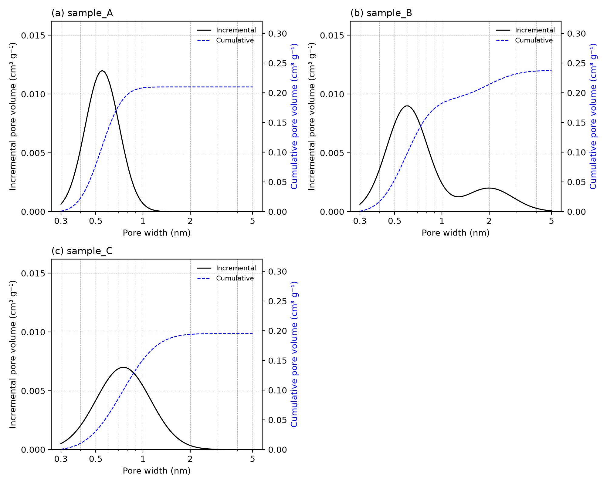

# PSD analysis

A small Python tool that automates pore-size distribution (PSD) analysis for porous materials. It reads PSD exports from a gas sorption (BET) instrument, calculates summary statistics for each sample and produces a side-by-side comparison plot.

I originally wrote it during my PhD to replace a slow, manual spreadsheet workflow for comparing activated carbon samples, and other researchers in the group went on to use it for their own data. This is a cleaned-up, simplified V1 of that tool, shared with **synthetic example data only**.



## What it does

For each sample it:

1. Reads the PSD export (`.xlsx` or `.csv`) and converts pore width from Å to nm.
2. Calculates volume-weighted statistics:
   - total pore volume
   - volume and fraction of micropores (< 1 nm) and small mesopores (1–5 nm)
   - average pore width and spread (standard deviation)
   - peak pore width and peak sharpness (full width at half maximum, FWHM)
3. Plots the incremental and cumulative PSD for every sample on shared axes, so they can be compared directly.
4. Saves the plot (`psd_comparison.png`) and a summary table (`psd_summary.csv`).

## How to run

```bash
pip install -r requirements.txt

# create the synthetic example files
python make_example_data.py

# run the analysis
python psd_analysis.py examples/*.csv --labels "Sample A" "Sample B" "Sample C" "Sample D"
```

Results are saved to `results/` (change with `--out`). If no labels are given, file names are used.

## Input format

Each file needs these three columns (the default headers from the instrument export I used):

| Column | Units |
|---|---|
| Pore Width (Å) | Å |
| Cumulative Pore Volume (cm³/g) | cm³/g |
| Incremental Pore Volume (cm³/g) | cm³/g |

A missing column stops the run with a clear error, rather than producing a wrong result.

## Limitations and next steps

This is a deliberately simple V1:

- **Fixed column names.** It expects the exact headers above. Next step: map columns from different instruments automatically, or let the user choose them.
- **Fixed pore-size boundaries** (1 nm and 5 nm). Next step: make these configurable.
- **No batch processing of whole folders or reports.** Next step: process a folder of samples and generate a short report automatically.
- **No uncertainty or repeat-measurement handling.** Next step: average repeat runs and show variation between them.

## Files

- `psd_analysis.py`: the analysis and plotting tool
- `make_example_data.py`: generates synthetic example PSDs (not real measurements)
- `examples/`: synthetic input files
- `results/`: example output
